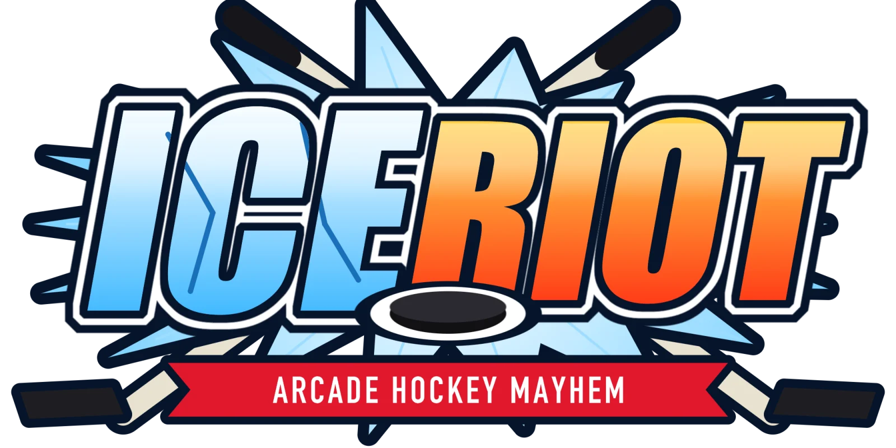
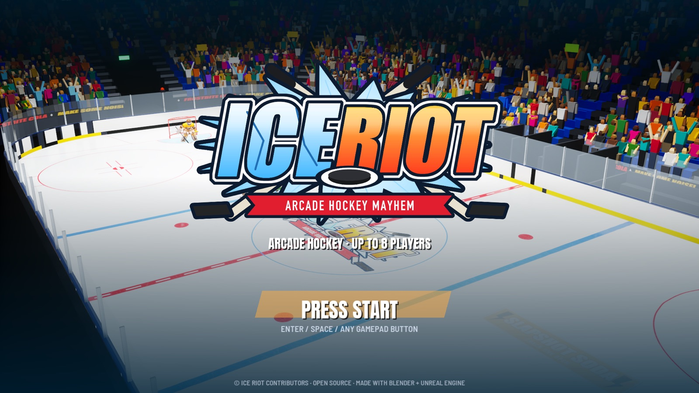
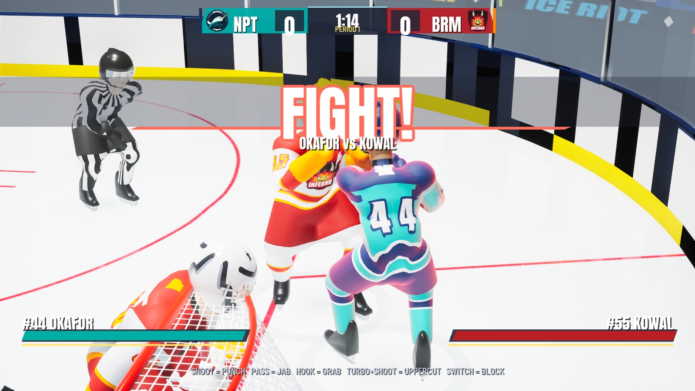
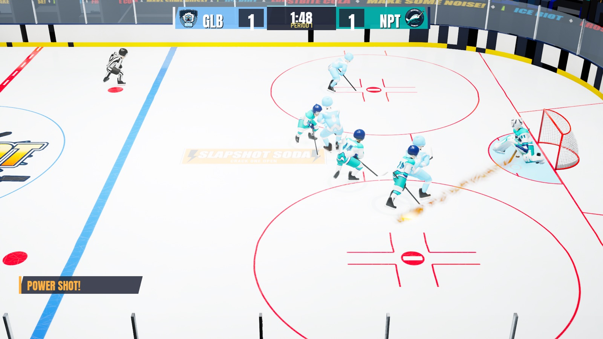
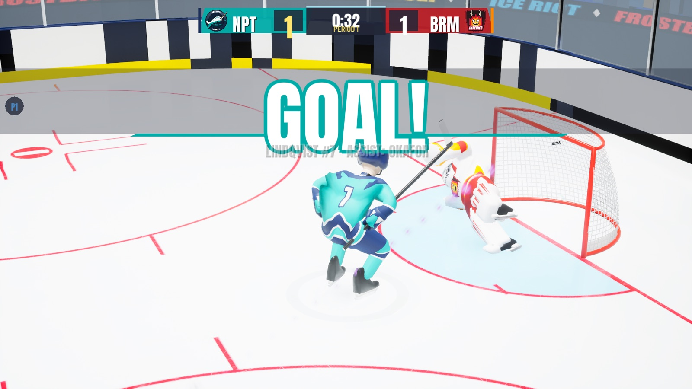
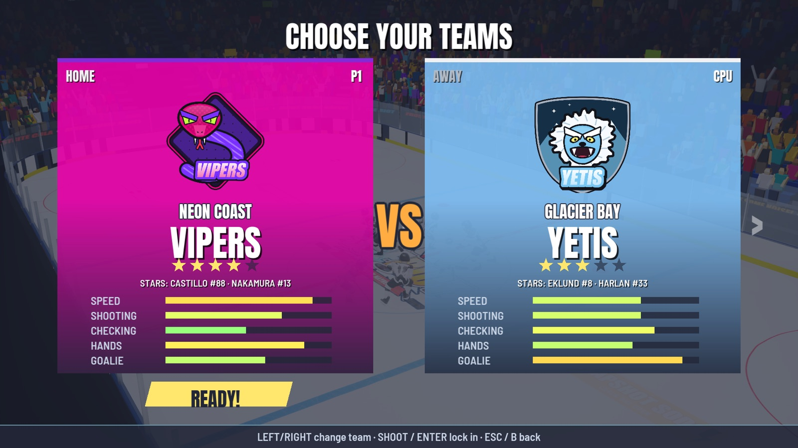
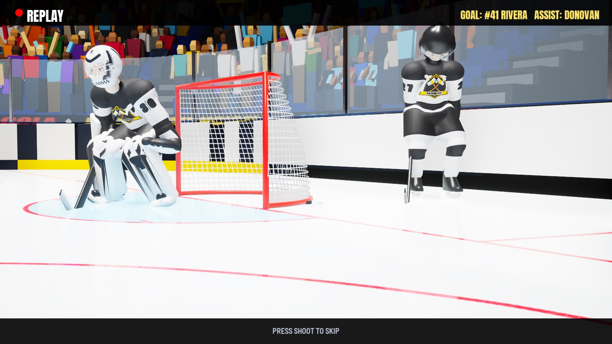

<p align="center"></p>

# ICE RIOT — Arcade Hockey Mayhem

An original, over-the-top **arcade hockey** game for up to **8 players**, inspired by the 3D arcade hockey
cabinets of the mid-90s and their Nintendo 64 ports: fast 3-on-3, turbo, flaming power shots, bone-rattling
power checks (cue the ambulance), fights, hat tricks and instant replays.

**[▶ Play it in your browser](https://nearbycoder.github.io/ice-riot/play/)** ·
**[Download for macOS](https://github.com/nearbycoder/ice-riot/releases/latest)** ·
[Website](https://nearbycoder.github.io/ice-riot/)

<p align="center">
  
  
  
  
  
  
</p>

[▶ Watch the gameplay trailer](site/media/trailer.mp4)

- **Engine:** Unreal Engine 5.9, gameplay written in C++ (`Source/IceRiot`), no Blueprints.
- **Art:** every model, texture, rig and animation is generated by Python scripts in Blender 5.3 (`Blender/`).
- **Audio:** every sound effect, crowd bed, organ riff, song and announcer line is synthesized (`Tools/gen_audio.py`).
- **Web:** the browser version is Unreal's own WebAssembly + WebGPU export of the same game.

## How the classics played (and what we kept)

Researched from the N64 instruction manual and period reviews — see [Docs/DESIGN.md](Docs/DESIGN.md):

| Classic mechanic | ICE RIOT |
|---|---|
| Arcade mode: 3 skaters + goalie, smaller rink, no rules | ✓ default (4-on-4 automatically for 7–8 humans) |
| Simulation mode with offsides, icing, penalties | **Pro rules**: icing, offside, tripping/hooking penalties, power plays |
| 1:30–3:00 periods, sudden-death overtime | 1:00–5:00, sudden death until someone scores |
| Tap = wrist shot, hold = slap shot | ✓ with a charge meter |
| Shoot + Turbo = power shot (net on fire) | ✓ flaming puck, burning net, goalie blown into the net |
| One-timer (Shoot + Pass) | ✓ one-timers and give-and-go |
| Check, steal, hook, trip, dive | ✓ plus turbo power checks that launch players |
| Anger meter → fights (jab, punch, grab, uppercut) | ✓ health/stamina, blocking; the winner's team gets RAGE |
| Turbo meter in the colored ring under your skater | ✓ the ring arc *is* the turbo meter |
| CPU goalies with "power saves" | ✓ a peppered goalie glows and stones the next shot |
| 7 camera angles, instant replay | 6 cameras + automatic goal replays |
| Weak single-player AI (the main complaint) | utility AI with support positions, passing lanes, difficulty scaling |
| Repetitive commentary (the other complaint) | 68 announcer lines with variations |

## Controls

| | Gamepad | Keyboard P1 | Keyboard P2 |
|---|---|---|---|
| Skate | Left stick / D-pad | W A S D | Arrow keys |
| Shoot (tap wrist / hold slap) · Check | A | J or Space | `,` or Numpad 1 |
| Pass · Poke check | X | K | `.` or Numpad 2 |
| Turbo | RT / RB / LT | L or Left Shift | `/`, Right Shift, Numpad 3 |
| Switch player · Deke spin | B | I | `;` or Numpad 4 |
| Hook · Drop pass | Y / LB | U | `'` or Numpad 5 |
| Camera | Back / View | C | |
| Pause | Start | Esc | P |

Combos: **Shoot + Turbo** power shot · **Shoot + Pass** give-and-go one-timer · **Turbo + Shoot** (defense)
power check · **Turbo + Pass** dive · **Turbo + Hook** trip. When a CPU teammate has the puck, **Pass** calls for
it and **Shoot** tells him to shoot. In a fight: Shoot punch, Pass jab, Hook grab, Turbo+Shoot uppercut, Switch block.

Secret codes: type them on the menus — `BIGHEAD`, `TINY`, `ALLSTAR`, `FRENZY`.

## Building

Requirements: macOS, Xcode, a source build of Unreal Engine 5.9 at `~/UnrealEngine` (override with `UE_ROOT`),
Blender 5.3, Git LFS. The web build also needs emscripten **6.0.10** (`WASM_EMSDK_ROOT`, default `~/emsdk`).

```bash
Tools/build_art.sh          # Blender: regenerate every model, texture and animation into Art/Export
Tools/import_assets.sh      # import the art into Unreal (/Game/IceRiot)
Tools/import_audio.sh --gen # synthesize and import all audio
Tools/import_fx.sh          # FX materials, HUD fonts, arena map
Tools/build.sh              # compile the C++ module
Tools/play.sh               # play (add -irwatch for CPU vs CPU)
Tools/package.sh mac        # Build/Packaged/Mac/IceRiot.app
Tools/package.sh web        # Build/Web/Wasm (the /play/ site)
```

Test hooks: `-irwatch` (CPU vs CPU), `-irautopilot`, `-irsimexit` (headless full games, see `Tools/simulate.sh`),
`-irperiod=<s>`, `-irpro`, `-irdiff=0..4`, `-ircam=0..5`, `-irbighead`, `-irfrenzy`,
`-autoshot=<dir>` (screenshots; see `Tools/shoot.sh`).

## License

MIT — see [LICENSE](LICENSE). All teams, players, logos, sponsors and announcer lines are fictional.
Fonts: Anton and Barlow (SIL Open Font License).
